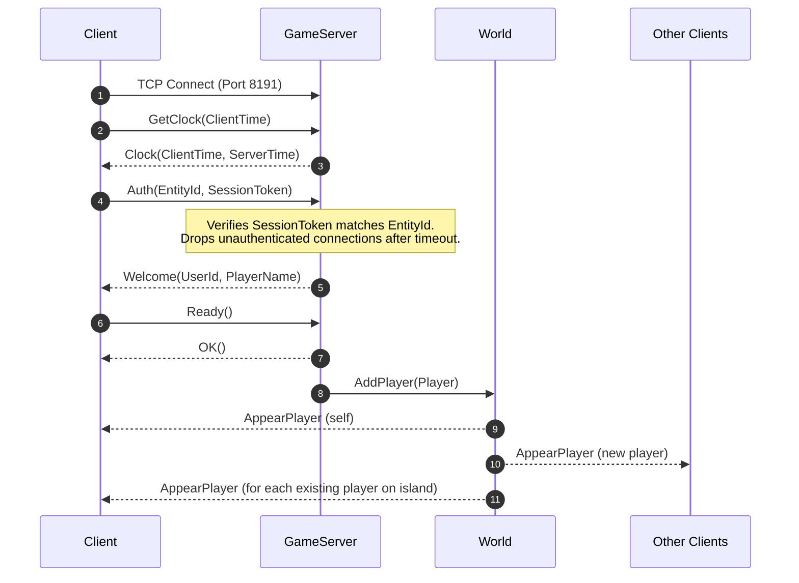

# Modular Server Architecture: Dedicated & Listen Server Engine

> **Project**: Durango: Community Edition (`Durango-CE`)  
> **Status**: In Progress (Phase 1: Decoupling & Isolation)  
> **Target Framework**: .NET Standard 2.1 (Client / Listen) & .NET 9.0 (Headless Dedicated)  
> **Primary References**:
> - [Safiqq/Durango-CustomServer](https://github.com/Safiqq/Durango-CustomServer)
> - [Kappach1n0D3V/ProjectDoorango](https://github.com/Kappach1n0D3V/ProjectDoorango)  
> **Local Reference Clones**: `<brain>/scratch/references/Durango-CustomServer` & `ProjectDoorango`

---

## 1. Architectural Vision

The goal is to decouple the local emulator from `Assembly-CSharp.dll` to build a modular, dual-mode server architecture similar to Minecraft:

```
               ┌────────────────────────────────────────────────────────┐
               │              Durango.ServerEngine (Shared)             │
               │  - Packet protocol & codecs (Messages / MsgPack)       │
               │  - GameServer (TCP 8191: Handshake, Session Auth)      │
               │  - Gateway (HTTP 8190: Admissions, Accounts, Terrains) │
               │  - World & Island Simulations (120 TPS tick loop)      │
               │  - Player state machine & Broadcast synchronization    │
               │  - Standalone data loading (DataStore / RegionCatalog) │
               │  - Unity Shims (Mathf, Vector, Random, ILogger)        │
               └───────────────────────────┬────────────────────────────┘
                                           │
                    ┌──────────────────────┴──────────────────────┐
                    ▼                                             ▼
       ┌────────────────────────┐                    ┌────────────────────────┐
       │   Dedicated Server     │                    │  Listen Server (Client)│
       │   (DurangoServer.exe)  │                    │    (Durango.exe / CE)  │
       │                        │                    │                        │
       │ - Standalone net9.0    │                    │ - Background thread    │
       │ - Headless Linux/Win   │                    │ - Solo offline (127.1) │
       │ - Binds 0.0.0.0 (WAN)  │                    │ - Host LAN / P2P       │
       │ - server.json / CLI    │                    │ - Direct Connect UI    │
       └────────────────────────┘                    └────────────────────────┘
```

1. **Dedicated Server**: A headless, standalone console application (`DurangoServer`) hosted on a remote Linux/Windows VPS, listening on `0.0.0.0`, with autosave and remote admin telemetry.
2. **Listen Server (Local / P2P)**: The client spins up the exact same `Durango.ServerEngine` in a background thread for solo offline play (`127.0.0.1`) or LAN/P2P hosting with friends.
3. **Dedicated Client**: In client mode, `Durango.exe` bypasses local server initialization and connects over TCP/HTTP to any remote server specified in `config.json`, `servers.json`, or the in-game Server Selection UI.

---

## 2. Multi-Session & Packet Handshake Lifecycle

Grounding analysis from `Durango-CustomServer/server/Core/`:

### A. HTTP Gateway Handshake (Port 8190)
1. **`GET /status`**: Returns `{"ok":true,"online":N,"version":"3.3.6"}`.
2. **`GET /knock`**: Returns compatibility and asset bundle index URLs.
3. **`POST /accounts`**: Returns character slot info (`max_player_slot_count`, `player_slot_count`) and player summaries.
4. **`POST /sessions`**: Client requests a session. Server issues a unique `session_token` and maps `token -> ownerKey` (`IssueSession`).
5. **`GET /entry?entity_id=<id>`**: Client sends `Authorization: Bearer <session_token>`. Server verifies owner key matches character, then binds token (`BindSessionToEntity`), returning `{"frontend_addresses":["<ip>:8191"],"cluster_mode":"Normal"}`.
6. **`GET /terrains/<id>/...`**: Streams chunk biomes, ocean, rivers, and landmark tiles to client.

### B. TCP GameServer Handshake (Port 8191)


### C. State Synchronization & Proximity Broadcast
- **Movement**: Client sends `Move` packet -> Server validates coordinates (`IsSaneMove`), updates `_context.AppearPlayer.Move`, and broadcasts `_world.BroadCast(msg)` to all players in the world.
- **Appearance & Equipment**: Changing gear, costume, or vehicle broadcasts `AppearPlayer.Display`.
- **Building & Farming**: `ArtifactPlaced`, `ArtifactCapsulated`, `FarmHarvest` broadcast changes to all players on the island.
- **Combat & Survival**: `Damaged`, `EntityDied`, `EntityRevived` broadcast damage numbers and animations in real time.
- **Item Drops**: Dropped items broadcast `AppearItem`; pickups broadcast `DisappearEntity`.

---

## 3. Implementation Phases & Progress

### Phase 1: Decoupling & Headless Architecture
- [x] **Analysis of Current Emulator**: Identified Unity lifecycle coupling (`GameManager.Update`, `UnityEngine.Random`, `Debug.Log`).
- [x] **Inspection of Reference Codebases**: Cloned and analyzed `Durango-CustomServer` and `ProjectDoorango`.
- [x] **Port Standalone Server (`src/Durango.Server/`)**:
  - [x] Integrated zero-dependency `Shims/` layer (`Mathf.cs`, `Vector2.cs`, `Vector3.cs`, `Random.cs`, `Debug.cs`).
  - [x] Ported `Messages/` protocol definitions and MsgPack serialization codecs.
  - [x] Decoupled `World.cs`, `Player.cs` (modular partials: Combat, Crafting, Building, Inventory, Animals).
  - [x] Standalone `DataStore.cs` and `RegionCatalog.cs` loading JSON/YAML assets directly from disk without Unity's `Resources.Load`.
  - [x] Configured `DurangoServer.csproj` targeting `.NET 9.0` (builds cleanly with 0 errors).
  - [x] Implemented fixed 120 TPS tick loop with CPU stopwatch telemetry and safe shutdown (`ShutdownSafely` on `SIGINT` / `SIGTERM` / `ProcessExit`).
- [x] **Build Script Integration**:
  - [x] Created `scripts/build-server.sh` compiling server binaries directly to `build/server/`.
- [ ] **Create Client Listen Adapter (`ListenServerBridge.cs`)**:
  - [ ] Embed server engine inside client to spin up on a background worker thread only when offline/hosting.

### Phase 2: Network Configuration & IP Binding
- [x] **Configurable Server Network Binding & `server.json`**:
  - [x] Implemented `server.json` configuration loader in `src/Durango.Server/Program.cs`.
  - [x] Created template `config/server.json` with `server_name`, `gateway_port`, `game_port`, `public_host`, `max_players`, `cluster_mode`, and admin settings.
  - [x] TCP `Listener.cs` binds to `IPAddress.Any` (`0.0.0.0`) for local and external connections.
  - [x] HTTP `WebServer.cs` binds wildcard `*` with automatic loopback fallback.
- [ ] **Client Connection Overhaul**:
  - [x] Support custom remote IPs and ports in [`config.json`](file:///home/safiqq/Durango-CE/config/config.json) via `CommunityConfig.cs`.
  - [x] `CommunityLink.cs` and `Clusters.cs` dynamically configure endpoints for remote dedicated servers.
  - [ ] Add direct-connect UI entry in the "Select Server" dialog.

### Phase 3: Multi-Session Handling & State Synchronization
- [ ] **Multi-Session Authorization**:
  - [ ] Implement token generation, `_sessionOwners` tracking, and `BindSessionToEntity`.
  - [ ] Implement `DropStaleUnauthenticated` timeout sweep.
- [ ] **Multi-Player State Broadcasting**:
  - [ ] Multi-client player lifecycle in `World.cs` (`PlayerAppeared`, `PlayerDisappeared`).
  - [ ] Movement packet validation (`IsSaneMove`) and broadcast relay.
  - [ ] Proximity-based entity appearance and synchronization.
  - [ ] Synchronized combat, building, and world item drops.

---

## 4. File Isolation Checklist

### Shared Core Engine (`src/Durango.ServerEngine/`)
| Component | Existing Location | Target Location | Description |
| :--- | :--- | :--- | :--- |
| **Shims** | *New* | `Durango.ServerEngine/Shims/` | `Mathf`, `Vector2`, `Vector3`, `Random`, `Debug` replacements for Unity |
| **Protocol** | `src/Assembly-CSharp/Messages/` | `Durango.ServerEngine/Messages/` | 985 packet message definitions and MsgPack codecs |
| **Network Core** | `Durango.Offline/Listener.cs`<br>`Connection.cs` | `Durango.ServerEngine/Network/` | Raw TCP socket server with configurable IP binding |
| **Game Server** | `Durango.Offline/GameServer.cs` | `Durango.ServerEngine/Core/GameServer.cs` | Multi-client connection dictionary, auth state machine |
| **Gateway** | `Durango.Offline/Gateway.cs`<br>`LocalGatewayServer.cs` | `Durango.ServerEngine/Core/Gateway.cs` | HTTP route dispatcher (`/knock`, `/accounts`, `/sessions`, `/terrains`) |
| **World** | `Durango.Offline/World.cs`<br>`WorldContext.cs` | `Durango.ServerEngine/Core/World.cs` | Multi-island tick simulation, entity spatial indexing, broadcast |
| **Player** | `Durango.Offline/Player.cs`<br>`PlayerContext.cs` | `Durango.ServerEngine/Core/Player*.cs` | Modular partials: Movement, Inventory, Building, Combat, Animals |
| **Data Loaders** | *New* | `Durango.ServerEngine/Support/` | `DataStore.cs`, `RegionCatalog.cs`, `MoCatalog.cs` for standalone JSON/YAML |

### Dedicated Host Application (`src/Durango.ServerHost/`)
| Component | Target Location | Description |
| :--- | :--- | :--- |
| **Entrypoint** | `src/Durango.ServerHost/Program.cs` | CLI argument parsing, 120 TPS tick loop, safe shutdown handlers |
| **Project File** | `src/Durango.ServerHost/DurangoServer.csproj` | Standalone `net9.0` console executable project |
| **Config File** | `src/Durango.ServerHost/server.json` | Dedicated server configuration (`bind_ip`, `ports`, `cluster_mode`, `max_players`) |

### Client Hooks & UI (`src/Assembly-CSharp/`)
| Component | Location | Description |
| :--- | :--- | :--- |
| **Listen Bridge** | `src/Assembly-CSharp/Durango.Offline/ListenServerBridge.cs` | Spawns background thread for `Durango.ServerEngine` on solo/LAN host |
| **Direct Connect** | `src/Assembly-CSharp/Durango.UI/TitleClusterSelection.cs` | UI input field to connect to any custom dedicated server IP:port |
| **Config Link** | `src/Assembly-CSharp/CommunityConfig.cs` | Reads remote server addresses and host mode preferences |

---

## 5. Session & LLM Continuity Instructions

When picking up development in a new chat session or model:
1. **Check this file**: Review this document (`docs/MODULAR_SERVER_ARCHITECTURE.md`) for current phase status and checkboxes.
2. **Review Reference Implementations**: Cached reference files are available in `<brain>/scratch/references/Durango-CustomServer/server/` and `ProjectDoorango/server/`.
3. **Compilation Verification**: Verify that client changes compile with `DOTNET=/home/safiqq/.dotnet/dotnet ./scripts/build.sh` (must maintain 0 errors across all 5 assemblies).
4. **Non-Destructive Approach**: Keep client listen functionality working at all times while progressively extracting engine modules.
